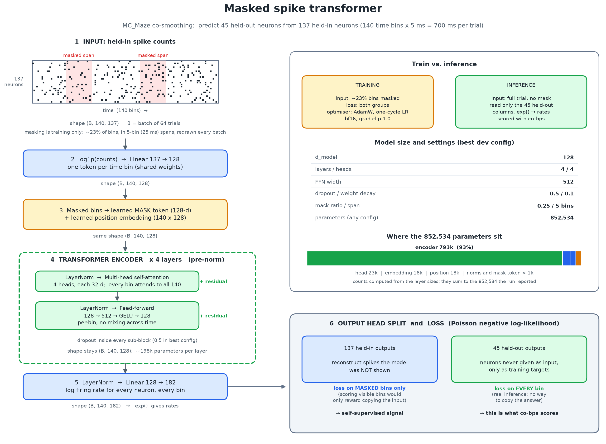
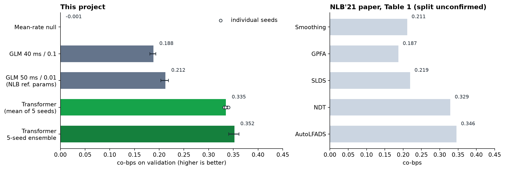
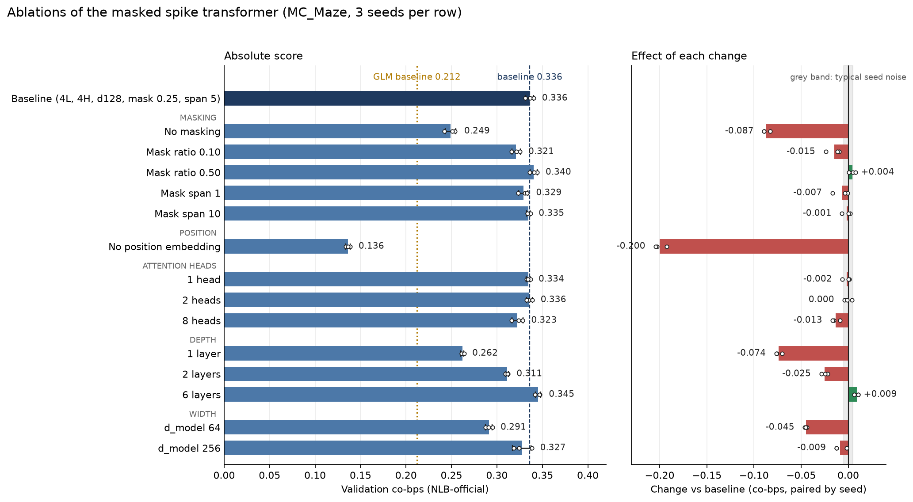
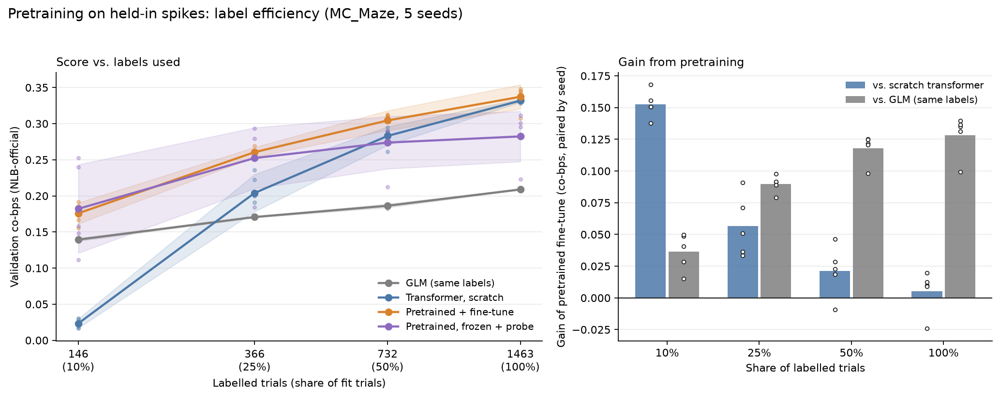

# neural-fm

A masked-reconstruction transformer for neural spiking data, trained and evaluated on the Neural Latents
Benchmark (NLB) **MC_Maze** dataset. The project covers the model, a set of baselines, multi-seed evaluation with
confidence intervals, ablations, and a self-supervised pretraining experiment.

Author: Shaun Quah



**Architecture of the masked spike transformer.** (1) Input: held-in spike counts for one trial, 137 neurons
by 140 time bins of 5 ms (700 ms). Red bands mark masked spans, used in training only (about 22% of bins, in spans of
5 bins, redrawn every batch). (2) Counts are transformed with log(1 + x) and linearly projected to 128 dimensions, one
token per time bin. (3) Masked bins are replaced by a learned mask token, and a learned position embedding is added.
(4) Four pre-norm transformer encoder layers, each a multi-head self-attention block (4 heads) followed by a
feed-forward network (FFN; 128 to 512 to 128 units with a GELU activation), both with residual connections.
(5) A linear head outputs the log firing rate of all 182 neurons in every bin. (6) The loss is the Poisson negative
log-likelihood: held-in neurons at masked bins only, held-out neurons at every bin. Right: training versus inference
settings, and where the 852,534 parameters sit (93% in the encoder). Abbreviations are listed under
[Abbreviations](#abbreviations).

## Abbreviations

| Term | Meaning |
|---|---|
| NLB | Neural Latents Benchmark |
| MC_Maze | the NLB dataset recorded in macaque motor cortex (MC) during a maze-reaching task |
| DANDI | Distributed Archives for Neurophysiology Data Integration (the data archive that hosts MC_Maze) |
| co-bps | co-smoothing bits per spike, the NLB score (higher is better) |
| GLM | generalised linear model; here, Poisson regression on smoothed spikes |
| NLL | negative log-likelihood, the training loss |
| SD | standard deviation (across seeds unless stated) |
| CI | confidence interval |
| NDT | Neural Data Transformer |
| AutoLFADS | automated Latent Factor Analysis via Dynamical Systems |
| GPFA | Gaussian-process factor analysis |
| SLDS | switching linear dynamical system |
| FFN | feed-forward network, the per-bin block inside each transformer layer |
| GELU | Gaussian error linear unit, an activation function |
| d_model | width of each token vector (128 by default) |
| bf16 | bfloat16, a 16-bit floating-point format (brain floating point) |
| CPU, GPU | central processing unit, graphics processing unit |
| CC-BY-4.0 | Creative Commons Attribution 4.0 licence |

## Task and data

MC_Maze ([DANDI 000128](https://dandiarchive.org/dandiset/000128), CC-BY-4.0) holds recordings from macaque motor
and premotor cortex during a delayed maze-reaching task: 1,721 training trials and 573 validation trials, each 700 ms
in 5 ms bins, 137 "held-in" and 45 "held-out" neurons.

The benchmark task is **co-smoothing**: given the held-in neurons' spikes, predict the held-out neurons' firing rates.
It is scored by **co-bps** (co-smoothing bits per spike above a mean-rate null; higher is better). The metric here is checked against
`nlb_tools.evaluation.bits_per_spike` in `tests/test_metrics.py` (that test is skipped if `nlb_tools` is not installed).

## Model

Each 5 ms bin is one token: held-in counts go through `log1p` and a linear layer to 128 dimensions. Random spans of
bins (about 22% of bins at the default settings) are replaced by a learned mask token, learned position embeddings are added, and a
4-layer pre-norm transformer encoder (4 heads, 852,534 parameters) feeds a linear head that predicts log firing
rates for all 182 neurons. The loss is Poisson negative log-likelihood: held-in neurons at masked bins only, held-out
neurons at every bin.

## Results

All numbers are co-bps on the public validation split (573 trials), scored once per run. Learning rates and early
stopping were chosen on a dev fold held out of the training trials. Selection was not perfectly blind: the first two
step-4 sweeps and the discarded first pretraining run also printed validation scores (for step 4 the dev fold picked the
same winner).

### Final evaluation

| Model | co-bps |
|---|---|
| Mean-rate null | -0.001 |
| Smoothing + Poisson generalised linear model (GLM), 50 ms, alpha 0.01 (NLB reference settings) | 0.212 [0.203, 0.219] |
| **Transformer, 5 seeds** | **0.335 ± 0.004** (standard deviation, SD) |
| Transformer, 5-seed ensemble | 0.352 [0.340, 0.361] |

Brackets are 95% trial-level bootstrap intervals. Paired against the reference GLM, each seed gains +0.119 to
+0.128 with every interval above zero (trial-level resampling only; it does not capture training-seed variance). The
5-seed ensemble improves on the GLM for 44 of 45 held-out neurons.



**Figure 1. Validation co-bps of the baselines and the transformer.** Left, this project (573 validation trials, higher
is better). Bars for the GLMs and the 5-seed ensemble show 95% bootstrap confidence intervals (CIs) over trials. The
transformer bar is the mean of 5 training seeds with a ±1 SD whisker, and white dots are the individual seeds.
"GLM 40 ms / 0.1" is a smoothing width of 40 ms with regularisation strength alpha 0.1 (my first setting);
"GLM 50 ms / 0.01" uses the NLB reference settings. The mean-rate null predicts each neuron's average rate and scores
about zero by construction. Right, published scores from Table 1 of the NLB'21 paper for context: Smoothing, Gaussian-process
factor analysis (GPFA), switching linear dynamical system (SLDS), Neural Data Transformer (NDT) and automated Latent
Factor Analysis via Dynamical Systems (AutoLFADS). The split used for that table is unconfirmed, so the right panel is
not a like-for-like comparison. Per-neuron and single-trial views of the same models (Figures 2 to 4), and the step 3 and step 4 figures, are
described in [`figures/README.md`](figures/README.md).

### Ablations (3 seeds each, one change at a time)

Seed-to-seed SD is mostly 0.002-0.006 (0.010 for d_model 256), so differences below roughly 0.005 are noise.

| Change | co-bps | vs baseline |
|---|---|---|
| Baseline | 0.336 | |
| No masking | 0.249 | -0.087 |
| No position embedding | 0.136 | -0.200 |
| 1 / 2 / 6 layers | 0.262 / 0.311 / 0.345 | -0.074 / -0.025 / +0.009 |
| 1 / 2 / 8 heads | 0.335 / 0.336 / 0.323 | -0.002 / -0.000 / -0.013 |
| d_model 64 / 256 | 0.291 / 0.327 | -0.045 / -0.009 |

Masking and position information are essential, depth helps, and head count from 1 to 4 makes no measurable
difference. The full table is in `RESULTS_SUMMARY.md`.



**Figure 5. Ablations: validation co-bps when one setting is changed at a time (3 seeds per row).** Left, absolute
score: each bar is the mean of 3 seeds, the whisker is ±1 SD, and the white dots are individual seeds. The baseline is
4 layers (4L), 4 attention heads (4H), d_model 128, mask ratio 0.25 and mask span 5. The dashed vertical line marks the
baseline mean (0.336) and the dotted line the NLB-reference GLM (0.212). Right, the change from the baseline computed
separately for each seed and then averaged, so that effects shared by a seed cancel. Green bars are gains and red
bars are losses. The grey band (±0.005) is typical seed-to-seed noise, so changes inside it are not distinguishable
from zero. Groups: masking (whether and how much input is hidden), position (learned position embedding removed),
attention heads, depth (number of layers) and width (d_model).

### Pretraining and label efficiency

The encoder is pretrained on held-in spikes only (no held-out labels), then adapted using a fraction of the
held-out labels. Every arm uses the same labelled trials and dev-chosen hyperparameters (learning rate; alpha for the
GLM), and the transformer arms share an 8,000-step budget (5 seeds).

| Labelled trials | GLM | Scratch | Pretrained + fine-tune |
|---|---|---|---|
| 10% (146) | 0.139 | 0.023 | 0.176 |
| 25% (366) | 0.171 | 0.204 | 0.261 |
| 50% (732) | 0.186 | 0.283 | 0.304 |
| 100% (1,463) | 0.209 | 0.332 | 0.337 |

Pretraining helps when labels are scarce: +0.15 over scratch at 10% labels and +0.06 at 25% (positive in every
seed). At 100% labels the gain is +0.005, with one seed going the other way, so there is no evidence of a gain
with full labels. At 10% labels the scratch transformer is worse than the GLM, so the fairer figure there is the
+0.04 over the GLM.



**Figure 6. Label efficiency of pretraining on held-in spikes (5 seeds).** Left, validation co-bps against the number of
held-out-neuron labelled trials used (10%, 25%, 50% and 100% of the 1,463 trials left after the dev fold). Lines are
means over 5 seeds, shaded bands are ±1 SD, and faint dots are individual seeds. Arms: GLM trained on the same labelled
trials; transformer trained from scratch (random initialisation); pretrained encoder with all weights fine-tuned;
pretrained encoder frozen with only the output head trained (probe). Right, the gain of pretrained fine-tuning over
the scratch transformer (blue) and over the GLM (grey), computed per seed: bars are means and dots are individual
seeds. A gain over the scratch transformer measures the effect of pretraining itself; a gain over the GLM also
includes the change of architecture.

## Limitations

- **Not comparable to the NLB leaderboard.** These are scores on the public validation split. The published NLB'21
  paper reports NDT 0.329 and AutoLFADS 0.346 for MC_Maze; which split that table uses is unconfirmed, so no claim of
  beating it is made. The ensemble figure is an extra, not the headline.
- **One animal, one session.** The pretraining experiment shows label efficiency for held-out neurons. It pretrains
  on held-in spikes from the same trials the labels come from, so it is not a cross-session or foundation-model result.
- **Untested train/test mismatch.** Held-out outputs are trained from masked inputs but scored on unmasked ones.
- **Ablations use 3 seeds**, and the baseline's dropout and weight decay were tuned at 4 layers and d_model 128.
- **A discarded run.** A first pretraining run used one learning rate for all label fractions and made the scratch arm
  unstable; it was redone with per-fraction learning rates. The discarded runs' JSON files are kept in
  `results/pretrain_v1_scratch_undertuned/` and are not used in any reported number.

## Reproducing

```bash
pip install -e ".[train,dev]"
pytest

# data (about 660 MB): creates data/000128/sub-Jenkins
pip install dandi
dandi download DANDI:000128 -o data
export NEURALFM_DATA=data/000128/sub-Jenkins     # PowerShell: $env:NEURALFM_DATA = "data/000128/sub-Jenkins"

python -m neuralfm.run_baselines                 # null and GLM baselines
python -m neuralfm.train --run-name final --dropout 0.5 --wd 0.1 --mask-ratio 0.25 \
    --mask-span 5 --epochs 400 --patience 100 --seed 0 --out results/step5   # repeat for --seed 1 2 3 4;
                                                 # notebooks/step5_final_evaluation.ipynb writes results/step5_results.json
python -m neuralfm.ablate --seeds 0 1 2          # about 1 hour on one GPU
python -m neuralfm.pretrain --stage lr           # dev-only learning-rate sweep
python -m neuralfm.pretrain --stage lr_frac --steps 8000 --out results/pretrain_v2 --lr-from results/pretrain
python -m neuralfm.pretrain --stage main --steps 8000 --out results/pretrain_v2
python -m neuralfm.glm_fraction                  # GLM on the same labelled subsets
```

Training was done on one RTX 5070 Ti; the final model trains in about 90 seconds.

## Docker (CPU)

The image bundles the code, CPU-only PyTorch, the tests and one trained checkpoint
(`models/final_s0.pt`, seed 0 of the final evaluation). It is about 1.7 GB, almost all of it PyTorch.
No GPU or dataset download is needed to build it.

```bash
docker build -t neural-fm .
docker run --rm neural-fm                        # run the tests
```

To re-score the bundled checkpoint, mount a folder containing `mc_maze_5ms.npz`, the processed
dataset that the first training or baseline run writes to `results/` (the data is not in the image
or the repository):

```bash
docker run --rm -v "$PWD/results:/data:ro" neural-fm python -m neuralfm.evaluate --cache /data/mc_maze_5ms.npz
```

It prints the official validation co-bps and compares it to the value recorded when the model was
trained (0.3313). On CPU it re-scores to 0.3317; the recorded run used bf16 on a GPU, so the check
allows a difference of 0.002. The container does not train models. The official-metric
cross-check test is skipped in the image because `nlb_tools` is not installed there.

## Repository layout

```
src/neuralfm/   model, data loading, metrics, baselines, training, ablations, pretraining, evaluate
models/         the one checkpoint bundled in the Docker image (plus its recorded result)
tests/          metric tests (match the official NLB function, null scores 0, bootstrap checks)
notebooks/      step5 (final evaluation), step6 (ablations), step7 (pretraining) with saved outputs;
                steps_3_4 is a walkthrough of the baselines and dev-fold sweep to run yourself
figures/        all figures
results/        per-run JSON results and logs (checkpoints and caches are not tracked)
```

## References

Pei et al., *Neural Latents Benchmark '21: Evaluating latent variable models of neural population activity*,
arXiv:2109.04463.
